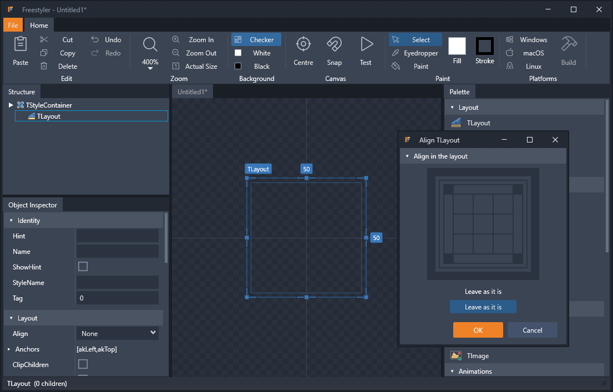

# Freestyler

**A style designer for Embarcadero FireMonkey (FMX).**
Freestyler is a replacement for the RAD Studio Style Designer. It runs as its own
application or inside RAD Studio 13, where it opens whenever you edit a TStyleBook.

**[Download the latest Freestyler](https://github.com/GrooverMD/Freestyler-Releases/releases/latest)**

## What's new

**0.9.2.0**
- Test window (F9): real FMX controls wearing your style, on FMX's Windows default for anything you
  haven't styled. Right-click a control to create its style from the default (or edit yours), or
  the window for backgroundstyle and windowborderstyle
- Multi-select in the Structure view (Ctrl/Shift+click) for cut, copy, paste and delete
- Closing every style leaves an empty workspace; dragging a control onto it starts a new style
- New styles are numbered (Untitled1, Untitled2); the unsaved mark (*) shows only for real changes
- Inside RAD Studio, every Freestyler window shows the Freestyler icon

**0.9.1.0**
- Several styles open at once, each in its own tab with its own undo
- Right-click menu on the canvas, the same as the Structure view's, with a new Align command
- Add Style > Forms: ready-made backgroundstyle and windowborderstyle
- Labels on the canvas show the StyleName; a dotted outline marks the selection's real bounds
- Freestyler opens with a new style ready to edit

**Designing**
- Ribbon interface with a dark theme designed for long design sessions
- Several styles open at once, each in its own tab with its own undo; copy and paste between them
- Multi-select in the Structure view (Ctrl/Shift+click) for cut, copy, paste and delete
- Structure view with drag and drop; a dropped control can be aligned as it is created
- Right-click menu on the Structure view and the canvas: cut, copy, paste, delete, align, reorder
- Add Style menu with ready-made form styles (windowborderstyle, backgroundstyle)
- Test window (F9): real FMX controls wearing your style, on FMX's Windows default for anything
  you haven't styled; right-click a control (or the window) to create its style from the default
- Object Inspector that expands sets, margins, padding, scale and other grouped properties
- Collapsible component palette using the RAD Studio component icons
- Canvas with zoom from 25% to 1600%, a checker, black or white background, and a Centre command

**Editing on the canvas**
- Selection frame with resize handles that show only where the control's Align and Anchors allow resizing
- Dotted outline on the control's real bounds, inside the frame
- Live width and height readouts; selection and parent container labelled by StyleName
- Snap and keyboard nudge
- Eyedropper, Fill and Stroke paint tools
- Colour editor with solid colours and gradients (add, move and remove stops)
- Full undo and redo

**Output**
- Opens and saves standard `.style` files
- Per-platform builds: one design, with overrides for Windows, macOS and Linux, built into a separate style for each

**RAD Studio integration**
- Tools > Freestyler Style Designer...
- Double-clicking a TStyleBook opens it in Freestyler; every save goes straight back into the form
- Apply to StyleBook puts the style being edited onto the form open in the designer

## Requirements

- Windows 10 or 11, 64-bit
- For the IDE add-in: RAD Studio 13 / Delphi 13 (64-bit IDE)

## Installing

1. Download `FreestylerSetup-<version>.exe` from [Releases](https://github.com/GrooverMD/Freestyler-Releases/releases).
2. Run it. Windows may show "Windows protected your PC" because the installer is not yet
   code-signed: click **More info**, then **Run anyway**.
3. To use Freestyler inside RAD Studio, tick **RAD Studio add-in** during setup, then in RAD Studio choose
   **Component > Install Packages > Add...** and select `FreestylerIDE370.bpl` from the `IDE` folder
   where Freestyler was installed.

## Reporting problems

Open an [issue](https://github.com/GrooverMD/Freestyler-Releases/issues) with the version (File > About),
what you did, and the `.style` file if you can share it.

## Licence

Freestyler is proprietary software, free to evaluate under the terms in [LICENSE](LICENSE).
The source code is not public.

Copyright (c) 2024-2026 Mark S Day. All rights reserved.

RAD Studio, Delphi and FireMonkey are trademarks of Embarcadero Technologies, Inc. Freestyler is not
affiliated with or endorsed by Embarcadero. Component icons are loaded from your RAD Studio installation
and remain Embarcadero's property.
